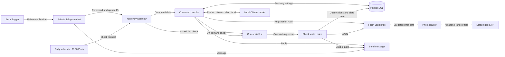

# Wishlist Price Tracker

A personal Telegram bot for tracking new-condition products on Amazon France. It saves a wishlist, checks prices on demand or every day at 09:00 Europe/Paris, and sends an alert when a target price is reached or a significant price decrease is observed.

## Alert rules

An alert qualifies when either condition is met:

- The current item price is at or below the user’s target.
- The decrease from the highest valid price observed since registration reaches the chosen percentage threshold (15% by default).

An unchanged qualifying price is not repeatedly announced. A lower price or a new qualifying episode can qualify again. Prices use integer cents and percentage thresholds use basis points.

## Architecture



This is a system overview. n8n owns orchestration; the adapter normalises provider responses; PostgreSQL owns persistent state. The local model only produces product labels. It never determines prices or alert eligibility.

## Workflows

| Export | Responsibility |
|---|---|
| `entry.json` | Telegram and daily schedule entry points. |
| `commands.json` | Authorisation, update deduplication, command routing, registration and replies. |
| `run.json` | Load active watches and check each product. |
| `check.json` | Evaluate one product, reserve eligible alerts and record delivery. |
| `fetch.json` | Retrieve and validate an observation, with bounded retries. |
| `send.json` | Deliver through Telegram or capture messages in the isolated demo inbox. |
| `error.json` | Notify the owner of unexpected automatic execution failures. |
| `demo.json` | Supply a controlled Telegram-shaped update for local testing. |

The JSON exports contain credential references, never credential values. They are saved inactive with isolated demo settings and fresh node identifiers. The generator creates deployment-specific exports from private local configuration.

## Requirements

- Docker Desktop with Docker Compose.
- Node.js 22 or newer.
- For live mode: a Telegram bot, the owner’s private chat ID and a configured price-provider account.

## Run the isolated demo

```sh
git clone https://github.com/tnyldrm23-afk/wishlist-price-tracker.git
cd wishlist-price-tracker
npm run bootstrap
npm test
```

Open [local n8n](http://localhost:5678) and complete the owner-account setup. Then, on this fresh demo installation:

```sh
npm run demo
```

Bootstrap creates `.env` with random local secrets, generates credential imports privately under `.runtime/`, starts the Compose services, imports the workflows and publishes the callable workflows and error handler. The Telegram/schedule entry remains inactive until live setup. Compose also starts the tunnel service; in demo mode, the Telegram entry is not published and no live price-provider credentials are configured.

The demo uses explicitly labelled price and model fixtures, real n8n executions and PostgreSQL records. It resets the demo dataset and refuses to run when live watches exist. Run it on an isolated demo installation, never against an active presentation deployment.

## Telegram commands

| Command | Purpose |
|---|---|
| `/watch <amazon.fr product URL> <target EUR> [discount %]` | Save a product and its thresholds. |
| `/list` | Read saved active products, targets and last observed prices. |
| `/check` | Check active products immediately. Live checks consume provider credits. |
| `/remove <tracking ID>` | Deactivate a tracking record while retaining its history. |
| `/help` or `/start` | Show usage instructions. |

Only the configured private chat is accepted. The wishlist is limited to five active products. Full HTTPS Amazon France product links are required; shortened URLs are rejected.

See [live setup](docs/SETUP.md), [reliability and error handling](docs/RELIABILITY.md), and [workflow screenshots](docs/SCREENSHOTS.md).

## Tests

```sh
npm test
```

The 46 unit tests cover parsing, authorisation, exact thresholds, repeated-price suppression, observation validation, offer normalisation and error-message safety. They do not use Amazon or Telegram credentials.

`npm run demo` exercises end-to-end scenarios on the isolated demo deployment. A fresh-clone Docker integration run is separate from the unit tests; see the setup instructions before running it.

## Scope and limitations

The current implementation covers Amazon France, EUR and new-condition item prices. Delivery charges and personalised coupons are excluded. Scrapingdog observations are timestamped when retrieved; that timestamp does not prove when Amazon last changed the offer. The reference price is the highest observed during tracking, not an independently verified market-wide historical price.

The laptop, Docker, network connection and provider quota must remain available. Temporary tunnels may require renewal. Missed scheduled checks are not guaranteed to replay after downtime. Farfetch and comparison across stores are future work.

Database locks and alert reservations reduce duplicates; exactly-once delivery across PostgreSQL and Telegram is not guaranteed. Unexpected execution failures use the shared Error Trigger workflow. Handled invalid-price results and AI fallbacks retain their own paths.

## Project layout

- `app/`: command rules, price adapter, demo service and webhook gateway.
- `workflows/`: importable, sanitised n8n JSON exports.
- `scripts/`: setup, generation, diagnostics and test helpers.
- `sql/`: PostgreSQL schema and migrations.
- `tests/`: offline unit tests.
- `docs/`: English setup, reliability notes and reviewed screenshots.

Credentials belong in ignored `.env` files or n8n’s credential store. Do not publish runtime logs, credential exports or screenshots of credential values.

Node labels describe their actions directly, such as `Read command and arguments`, `Choose command action`, `Check target and discount` and `Save price and reserve alert`. Code expressions and connection references use the same labels.
