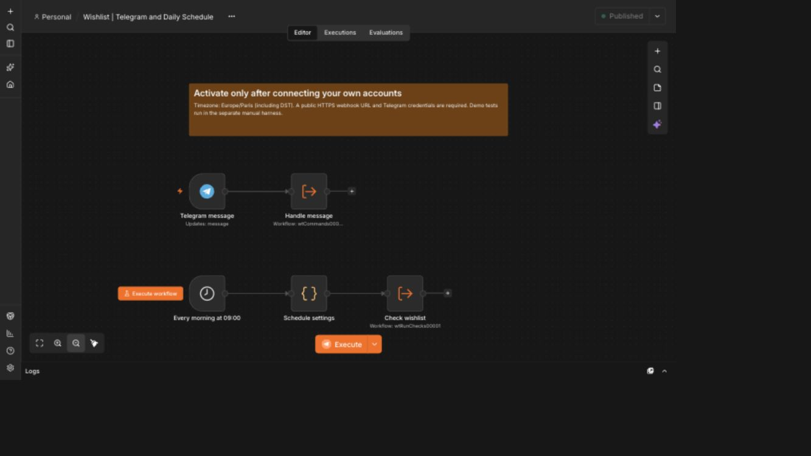
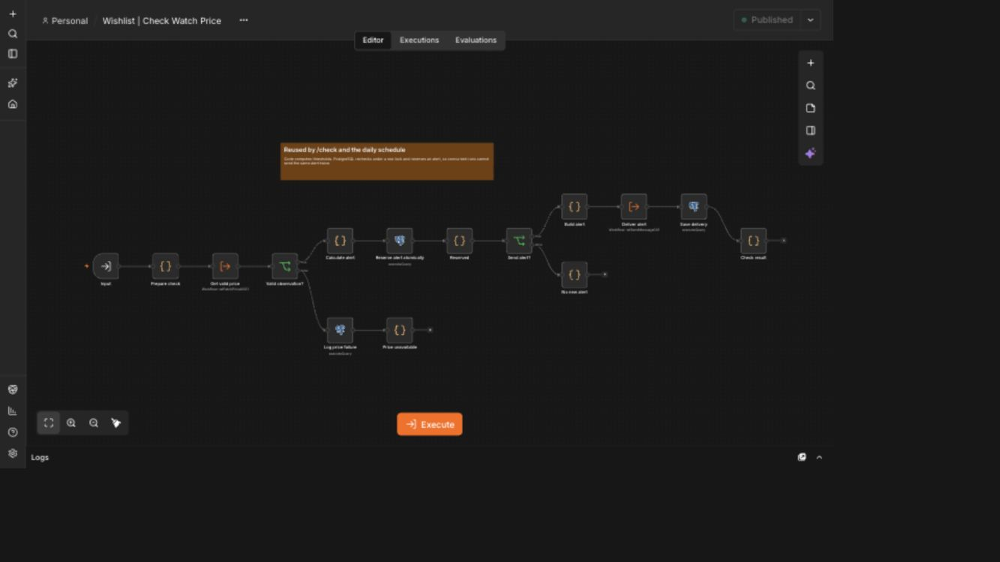

# Workflow screenshots

These are reviewed n8n canvas screenshots. They show workflow structure without credential values or execution payloads. They are structural illustrations rather than evidence that a current provider request succeeded.

## Entry points

Telegram messages and the daily schedule call the appropriate sub-workflows.

## One-product price check

The workflow obtains a valid observation, calculates eligibility, reserves an alert and records delivery. Invalid observations follow the lower branch.

The shared Error Trigger handler was added after these canvas screenshots. Its current definition is included in `workflows/error.json`.
